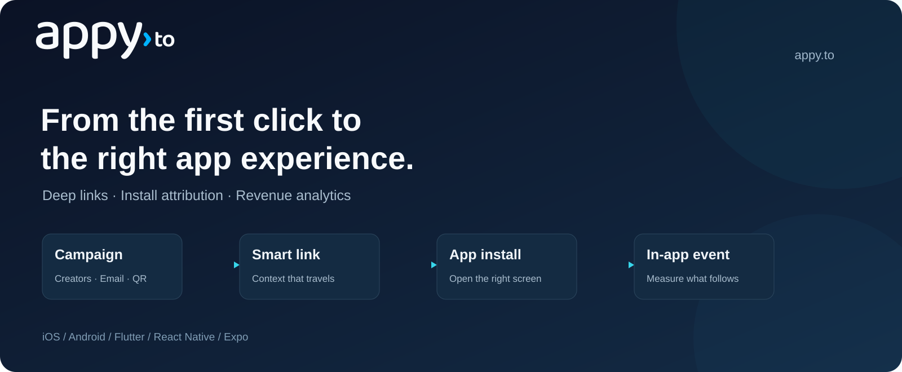

  

  <a href="https://appy.to">Website</a> ·
  <a href="https://appy.to/docs">Documentation</a> ·
  <a href="mailto:support@appy.to">Contact</a>

Appy connects campaign links to the right app experience, and helps teams measure the installs, in-app events and revenue that follow. Build with smart links, dynamic QR codes and mobile SDKs.

### Choose your SDK

| Platform | Repository | Start here | Availability |
| --- | --- | --- | --- |
| iOS · Swift | [appy-ios-sdk](https://github.com/appy-to/appy-ios-sdk) | [Quickstart](https://github.com/appy-to/appy-ios-sdk/blob/main/QUICKSTART.md) | 1.0.0 · Swift Package Manager |
| Android · Kotlin / Java | [appy-android-sdk](https://github.com/appy-to/appy-android-sdk) | [Quickstart](https://github.com/appy-to/appy-android-sdk/blob/main/QUICKSTART.md) | 1.0.0 · [Maven Central](https://central.sonatype.com/artifact/to.appy/appy-sdk/1.0.0) |
| Flutter · Dart | [appy-flutter](https://github.com/appy-to/appy-flutter) | [Quickstart](https://github.com/appy-to/appy-flutter/blob/main/QUICKSTART.md) | 1.0.0 · [pub.dev](https://pub.dev/packages/appy_sdk) |
| React Native · Expo | [react-native-appy](https://github.com/appy-to/react-native-appy) | [Quickstart](https://github.com/appy-to/react-native-appy/blob/main/QUICKSTART.md) | 1.0.0 · [npm](https://www.npmjs.com/package/react-native-appy) |

### Get started

1. Open **Apps & SDK** in the Appy dashboard and register your own app.
2. Copy its **Publishable key** and **Link domain** from **SDK setup**.
3. Follow your SDK's quickstart above, then test a link on your device.

Your app keeps its own name and identifiers; Appy is the library you add to it. [Understand the example values](https://github.com/appy-to/appy-ios-sdk/blob/main/SETUP.md).

### What you can build

- Open the right screen from campaigns, QR codes, email and social links.
- Recover link context after installation where a supported match is available.
- Connect installs, in-app events and revenue to acquisition campaigns.
- Integrate backend workflows through the [REST API](https://api.appy.to/docs) or [use the link API without an SDK](https://appy.to/docs/sdk/http).

### Support and availability

SDK source is MIT-licensed. Hosted SDK features require an Appy Enterprise plan. All four SDKs are available at version 1.0.0 through Swift Package Manager, Maven Central, pub.dev and npm. Follow the quickstart for your platform.

For integration questions, read the selected SDK guide, open an issue in its repository, or email [support@appy.to](mailto:support@appy.to).
